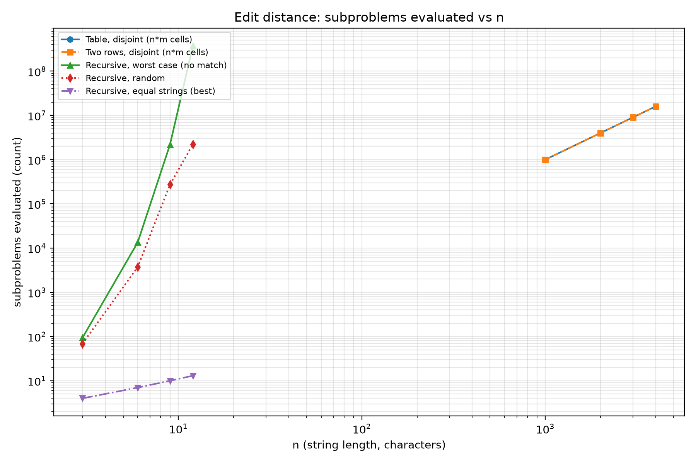
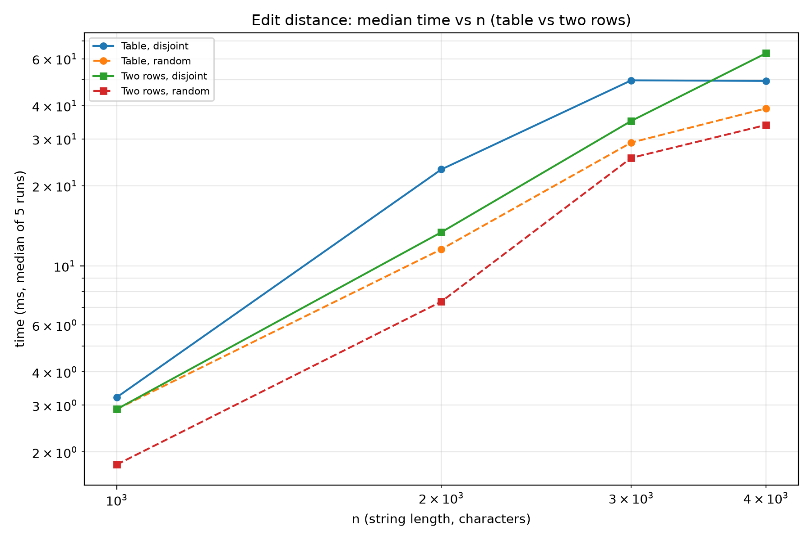
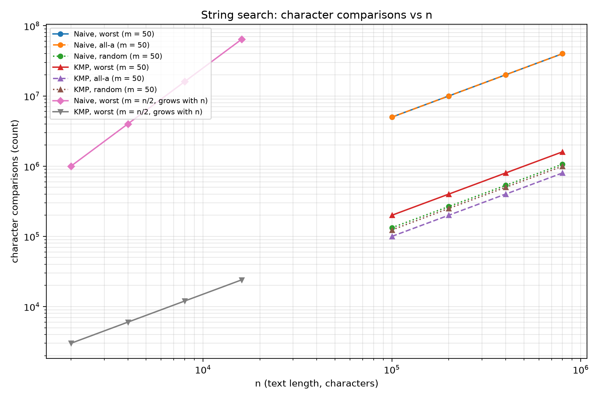
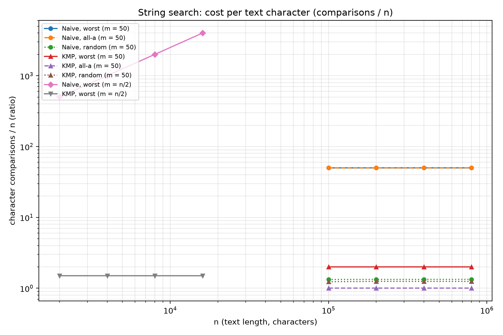

# Assignment 4 - Report: Dynamic Programming and String Algorithms

City Search & Spell-Check: three edit-distance versions and two string-search
algorithms, with counters, a reproducible experiment and JUnit 5 tests.

## Experiment Design Card

| Card field | What I wrote **before** the runs |
|---|---|
| **Question** | Edit distance: does the number of subproblems grow the way the theory says - exponentially for plain recursion and like `n*m` for the table / two-rows? String search: does Naive grow like `n*m` while KMP stays linear in `n+m`? |
| **Sizes (n)** | Edit distance **recursion**: `3, 6, 9, 12` (it is exponential, so it cannot go further). Edit distance **table / two-rows**: `1000, 2000, 3000, 4000`. Search **fixed pattern** `m = 50`: `n = 100 000, 200 000, 400 000, 800 000`. Search **growing pattern** `m = n/2`: `n = 2 000, 4 000, 8 000, 16 000`. Every list has 4 sizes and the largest is at least 4x the smallest. |
| **Inputs** | Edit distance: `random` (average), `equal` (best case for the recursion), `disjoint` = `a^n` vs `b^n` (worst case: no character ever matches). Search: `random` (average), `worst` = `a^n` vs `a^(m-1)b` (classic Naive worst case), `all-a` = `a^n` vs `a^m` (many overlapping matches), and `worst m=n/2` (a growing pattern, the input that exposes the `n*m` term). |
| **Metrics** | `states` for Edit Distance = the number of subproblems/cells the algorithm evaluates. `char_comparisons` for search = the number of character comparisons. Both are counted **inside** the algorithm, one increment per unit of work. Plus wall-clock time as the **median of 5 runs** (median of 3 for the recursion). |
| **Prediction** | Recursion: exponential call count. Table / two-rows: exactly `(n+1)*(m+1)` states and both grow like `n^2`. Naive on the worst case: about `n*m` comparisons (slope 2 when `m=n/2`). KMP: about `n+m` comparisons on every input. Time should follow the counters but be noisier because of memory allocation. |
| **Plots** | (1) `states` vs `n` - exponential vs quadratic. (2) edit-distance time vs `n` - table vs two-rows. (3) search `comparisons` vs `n` - the `n*m` slope of Naive. (4) `comparisons / n` - cost per text character (a ratio). |

Everything above was written before the first run. Nothing was changed afterwards.

## Plots and Results

### 1. Edit distance: subproblems evaluated vs n



**Takeaway:** the table and two-rows evaluate exactly `(n+1)^2` cells and grow like
`n^2`, while plain recursion on the worst case (`a^n` vs `b^n`) leaves them far
behind and explodes exponentially.

Measured `states`: table / two-rows = `1 002 001, 4 004 001, 9 006 001,
16 008 001` = `(n+1)^2` exactly. Recursion on `equal` grows linearly
(`4, 7, 10, 13`), on `random` it is already in the millions at `n=12`
(`2 233 734`), and on `disjoint` it is `377 393 953` at `n=12` - **about 24x more
work than the whole `16 008 001`-cell table at `n=4000`.**

### 2. Edit distance: median time vs n (table vs two rows)



**Takeaway:** the two-row version costs essentially the same time as the full
table, so the memory it saves is free.

At `n=4000` the table needs `34-50 ms` and two-rows needs `34-63 ms` (random
39.1 vs 33.8 ms; disjoint 49.5 vs 62.9 ms), i.e. the curves overlap: using two
rows is a **memory** optimisation, not a time one.

### 3. String search: character comparisons vs n



**Takeaway:** with a fixed pattern length every curve is a straight line of slope
1 (a constant factor between them), but as soon as the pattern grows (`m=n/2`)
Naive bends up to slope 2 while KMP stays on slope 1.

Measured comparisons at `n = 800 000`, `m = 50`: Naive worst `39 997 550` vs KMP
worst `1 599 951` - **25x fewer**. With a growing pattern, at `n=16 000`
(`m=8 000`) Naive does `64 008 000` comparisons while KMP does `24 001`
(**2600x fewer**), because Naive's work is `~n^2/4` and KMP's is `~1.5n`.

### 4. String search: cost per text character (comparisons / n)



**Takeaway:** with a fixed `m=50` Naive pays a constant `~50` comparisons per
text character (KMP `<= 2`), and with a growing pattern Naive's cost *per
character* keeps rising while KMP's stays flat at `~1.5`.

## Prediction vs Result

**Edit distance.** My prediction was "recursion exponential, tables exactly
`(n+1)(m+1)`". The counters confirmed it exactly - the table says `16 008 001`
cells for `n=4000`, and the recursion needed `377 393 953` calls for `n=12`. What
**surprised** me a little was how cheap the table is next to KMP-like work: even
`n=4000` (16 million cells) finishes in tens of milliseconds, while `n=12`
recursion already takes `0.76 s`.

**String search.** My prediction was "Naive `~n*m`, KMP `~n+m`". The counters
matched. The surprise was in the **time**: KMP's slowest measured point was not a
mismatch case but the `all-a` input (`25.6 ms` at `n=800 000`), because there it
finds `800 000` overlapping matches and the result list, not the comparisons,
dominates.

## Short Answers

**Which input made your string search slowest, and why?**
For Naive, the two worst-case inputs: `a^n` vs `a^(m-1)b` (fixed `m=50`) and the
growing-pattern `a^n` vs `a^(n/2-1)b`. In both, almost every alignment matches the
first `m-1` characters and then fails on the last one, so Naive re-compares nearly
the whole pattern at every one of the `n` start positions - about `n*m`
comparisons. Among the counts, the growing-pattern case is the slowest overall
(`64 008 000` comparisons at `n=16 000`). For KMP the slowest *time* was the
`all-a` input, but that is the result list, not the matching.

**How large an n could the recursive Edit Distance handle, and what stopped it?**
Up to about `n = 12` on the worst case, where it already takes `377 393 953`
calls / `0.76 s`; `n = 13` would be roughly three times that. What stops it is the
**number of calls**, which grows like the Delannoy numbers (~`5.8^n`), not the
recursion depth (only `O(n)`, which is harmless). The table removes this
completely: `n=4000` is only 16 million cells and runs in tens of milliseconds.

**What do you gain and what do you lose when you use two rows instead of the full table?**
You gain memory: the extra space drops from `O(n*m)` to `O(m)`. At `n=m=4000` that
is `4001` integers per row (`~32 KB` for two rows) instead of a `4001x4001` table
(`~64 MB`) - about a **2000x** reduction - and the time is unchanged (measured
within noise). You lose the rest of the table, so you can no longer walk back
through it to read the actual sequence of insertions/deletions/replacements; if
you need the edit script you must recompute it (e.g. with a divide-and-conquer
pass) or keep the full table.

**If you had to choose one string search for your city platform, which one and why?**
KMP. Typo search and log scanning both hit adversarial-ish text - long runs of the
same character, repeated separators - which is exactly where Naive degrades to
`O(n*m)`; KMP guarantees `O(n+m)` and never moves backwards in the text. The cost
KMP pays is one extra `O(m)` LPS array, which is negligible next to the text. On
random text Naive is only marginally cheaper, so there is little reason to accept
its worst case.

## One Paragraph on Time

The measured times followed the counters but were clearly **noisier**: for the
edit-distance table the same cell count sometimes ran 2x faster or slower
(e.g. `n=2000` took `8.9-23.0 ms`), because each call allocates a fresh
`(n+1)x(n+1)` array and garbage collection lands inside some runs, and the JIT
warms up during the first points. That is exactly why the counters are the main
evidence here: `states` and `char_comparisons` are integers produced by the
algorithm itself, identical on every machine and every run, so the exponential vs
quadratic vs linear shapes in the plots are not an artefact of the laptop. The
clock is used only to show that the differences are real in practice (largest
observed: recursion `n=12` at `0.76 s` vs table `n=4000` at `~50 ms`; Naive worst
`48 ms` vs KMP worst `10 ms` at `n=800 000`).

## How to reproduce

```bash
mvn test                 # 10 JUnit 5 tests
mvn -q compile exec:java # self-checks reference values, writes results/results.csv
py -3.13 scripts/plot.py # redraws results/plots/*.png from the CSV
```

The generator is seeded (`Benchmark.SEED = 42`), so the same command always
produces the same `results.csv`.
